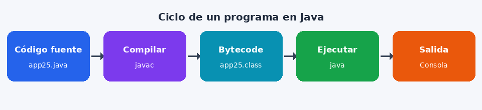

# Lección 1: ¡Hola, Mundo!

Todo programador empieza con este programa. Su único trabajo es **mostrar un mensaje en la consola**.



## ¿Qué vas a practicar?

1. Escribir el código **a mano** (no se permite pegar).
2. Presionar **Compilar**: el compilador `javac` revisa que el código esté bien escrito.
3. Presionar **Ejecutar**: la máquina virtual de Java corre tu programa.

## Código a copiar

```java
void main() {
    IO.println("¡Hola, Mundo!");
}
```

> 💡 Desde Java 25 se puede escribir `void main()` sin declarar una clase.
> `IO.println(...)` imprime un texto y salta de línea.

## Objetivo

Compila y **ejecuta** el programa sin errores. Debes ver `¡Hola, Mundo!` en la consola.
